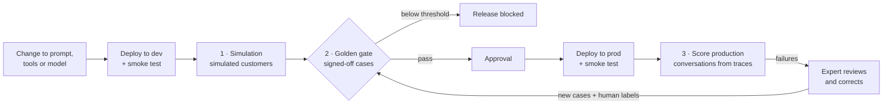

# Foundry agent evaluation pipeline

A small, working example of Microsoft's recommended way to release an AI agent on Microsoft Foundry: **the same evaluators at three moments**, plus a feedback loop where domain experts turn real failures into permanent tests.

The agent is a Contoso Pizza order assistant (a Foundry hosted agent built with Microsoft Agent Framework), but the pipeline is the point.



## The three moments

All three use the same evaluators (`contoso-order-policy` and `builtin.tool_use_quality`), declared once in [`evals/azure.eval.yaml`](evals/azure.eval.yaml).

| Moment | When | What runs | File |
|---|---|---|---|
| **1. Before launch** | Every release, before real users | Simulated customers hold multi-turn conversations with the agent | [`datasets/scenarios.jsonl`](datasets/scenarios.jsonl) |
| **2. On every change** | Every PR and every push to `main` | Signed-off golden cases. **Below 90% pass rate, the release stops.** | [`datasets/golden.jsonl`](datasets/golden.jsonl) |
| **3. In production** | Daily | Real conversations scored from Application Insights traces | [`production-eval.yml`](.github/workflows/production-eval.yml) |

## Closing the loop

1. The daily production evaluation finds conversations that the judge failed.
2. `scripts/feedback.py harvest` adds them to `datasets/golden.jsonl` as `needs_review` and opens a pull request.
3. A planner or domain expert edits each row in the browser. They record whether the agent was right (`human_verdict`) and what the correct behaviour is (`ground_truth`).
4. The PR can't go green until every row has been reviewed. Merging makes every real failure a permanent test for the golden gate.
5. `human_verdict` next to `judge_verdict` gives human labels to check the judge: `python scripts/feedback.py calibrate`.

### Why judge calibration matters (what we found building this)

The first golden run scored **70% and blocked the release, although the agent was right in every case**:

- `builtin.task_completion` failed the agent for asking for a missing order number, for declining a flight booking and for refusing to process a card number. The judge didn't know these were the correct behaviours. Fix: a rubric evaluator generated from the agent's own instructions (`azd ai eval generate --evaluator`, stored in [`evals/evaluators/contoso-order-policy.json`](evals/evaluators/contoso-order-policy.json)).
- The custom rubric then said the agent "guessed" store hours. It only saw the final text, not the tool calls. Fix: map `response` to `sample.output_items` in the eval configuration.

After both fixes: 100%. Without human labels, you would have "fixed" a correct agent.

## Around the evaluations

- **No stored secrets.** GitHub signs in to Azure with OpenID Connect (federated credentials for `dev`, `prod`, `prod-monitor` and pull requests). The identity has only **Contributor** on the two Foundry projects (to deploy the agent) and **Foundry User** plus **Cognitive Services OpenAI User** on the Foundry resource (to call the agent and the judge and simulator models).
- **Smoke test** after every deployment ([`scripts/smoke_test.sh`](scripts/smoke_test.sh)): a real question that needs a tool call.
- **Production needs an approval**: the `prod` GitHub environment has a required reviewer and only accepts `main`.
- **Prompt, tools and model are released together.** [`instructions.py`](src/order-agent/instructions.py), [`tools.py`](src/order-agent/tools.py) and the model deployment (`FOUNDRY_MODEL_NAME`, wired in [`azure.yaml`](azure.yaml)) are all in Git. Any change to them is a PR that runs the gate.

## Repository layout

```text
src/order-agent/           hosted agent: prompt, tools, code
datasets/golden.jsonl      signed-off cases (grows from production reviews)
datasets/scenarios.jsonl   simulation scenarios
evals/azure.eval.yaml      the three evals, one evaluator set
evals/evaluators/          rubric evaluator, versioned in Git
scripts/feedback.py        check / harvest / calibrate
.github/workflows/         release.yml, production-eval.yml
```

## Run it yourself

Prerequisites: [Azure Developer CLI](https://learn.microsoft.com/azure/developer/azure-developer-cli/install-azd), the Foundry extensions (`azd ext install azure.ai.agents azure.ai.evaluations`), and a Foundry project with a model deployment.

```powershell
azd env new dev
azd env set FOUNDRY_PROJECT_ENDPOINT https://<account>.services.ai.azure.com/api/projects/<project>
azd env set AZURE_AI_PROJECT_ENDPOINT https://<account>.services.ai.azure.com/api/projects/<project>
azd env set AZURE_AI_PROJECT_ID <project resource ID>
azd env set FOUNDRY_MODEL_NAME gpt-4.1-mini
azd deploy order-agent
azd ai agent invoke order-agent "Where is my order CP-1001?"

azd ai eval create golden-gate
azd ai eval run start --eval golden-gate --fail-on pass-rate=0.9
```

For CI, follow [Set up CI/CD for a hosted agent](https://learn.microsoft.com/azure/foundry/agents/quickstarts/set-up-cicd-hosted-agent) to create the federated identity. Then set the repository variables `AZURE_CLIENT_ID`, `AZURE_TENANT_ID`, `AZURE_SUBSCRIPTION_ID`, `AZURE_LOCATION`, `AZURE_RESOURCE_GROUP` and `FOUNDRY_MODEL_NAME`, plus `FOUNDRY_PROJECT_ENDPOINT` and `AZURE_AI_PROJECT_ID` per environment.

## Microsoft documentation

- [Evaluate generative AI apps and agents (overview)](https://learn.microsoft.com/azure/foundry/concepts/observability)
- [Simulate conversations to evaluate an agent](https://learn.microsoft.com/azure/foundry/observability/how-to/cloud-evaluation-simulate-conversations)
- [Run evaluations in GitHub Actions (azd quality gate)](https://learn.microsoft.com/azure/foundry/how-to/evaluation-github-action)
- [Evaluate deployed agent conversations](https://learn.microsoft.com/azure/foundry/observability/how-to/cloud-evaluation-deployed-conversations)
- [Continuous and scheduled evaluation](https://learn.microsoft.com/azure/foundry/observability/how-to/continuous-scheduled-evaluation)
- [Set up CI/CD for a hosted agent](https://learn.microsoft.com/azure/foundry/agents/quickstarts/set-up-cicd-hosted-agent)
- [Authenticate to Azure from GitHub Actions with OpenID Connect](https://learn.microsoft.com/azure/developer/github/connect-from-azure-openid-connect)
